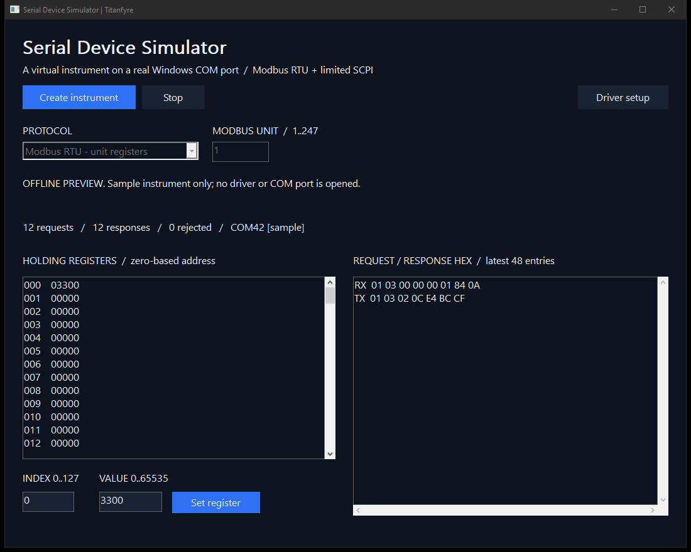

# Serial Device Simulator

<!-- full-version-contact:start -->
> [!IMPORTANT]
> **Get the version without the one-hour demo limit**
>
> **Discord · `titancsa`**. Open [Discord](https://discord.com/app), choose **Friends → Add Friend**, enter **`titancsa`** and send a message.
> Send the project name and ask for its full version. TitanCSA will share the purchase details privately.
>
> **FR · Version sans la limite d’une heure.** Ajoute **`titancsa`** sur Discord et envoie le nom du projet. Le lien d’achat est communiqué en privé.
<!-- full-version-contact:end -->

> **Engineering preview: live COM transport is not validated.** Offline protocol and memory checks pass, but a disposable Windows 10 VM selected `usbser.sys` and then stalled during device startup. No successful serial transfer was verified, and guest shutdown also stalled. Usable application/driver release binaries are withheld while the backend is investigated. Do not deploy this preview on a production PC.

**A C++ protocol simulator for Modbus RTU and a small SCPI instrument.** The tested offline model supports editable registers and bounded request/reply processing. Its experimental Vdevice USB CDC backend is intended to expose an ordinary Windows COM port; live transport remains unverified as stated above.



[Source preview](https://github.com/titanfyre/Serial-Device-Simulator) | [Virtual COM Workbench](https://github.com/titanfyre/Virtual-COM-Workbench) | Production driver / OEM support: Discord **`titancsa`**

## Install and use

The following workflow is the intended interface after live transport is fixed and verified. No ready-to-install release is available yet.

1. Extract the complete Windows release ZIP. Run `Dependencies/VdeviceSetup.exe`, install the signed **Vdevice demo**, and restart Windows only if setup requests it.
2. Open `SerialDeviceSimulator.exe`. Choose **Modbus RTU** or **SCPI**; for Modbus, choose unit address **1..247**.
3. Click **Create instrument** and approve administrator elevation. Wait for the **Ready on COMx** message.
4. Open **that COM port** in your client application. The simulator never opens an existing physical COM port. Windows chooses the new port number; existing port names are retained.
5. For Modbus, read holding register **0**: its default is **3300**. Use **Set register** to change a zero-based address **0..127**, value **0..65535**, while your client is running.
6. For SCPI, send `*IDN?` followed by a newline, or `MEAS:VOLT?`. Responses end with a newline. Register 0 is displayed in volts as a value in millivolts.
7. **Stop** or closing the application removes its owned virtual instrument. Changing protocol or unit address requires stopping and creating another instrument.

The left pane displays holding registers; the right pane retains the latest 48 request/response hex entries. Neither device data nor configuration is uploaded. There is no background startup service for this application.

## Supported protocol scope

| Mode | Implemented |
| --- | --- |
| Modbus RTU | Functions **01, 02, 03, 04, 05, 06, 15 and 16**; CRC-16; separate 128-element holding/input/coil/discrete maps; unit addressing; broadcast writes without replies; exception codes for unsupported functions and invalid ranges/values |
| SCPI subset | `*IDN?`, `*OPC?`, `*RST`, `*CLS`, `SYST:ERR?` / `SYSTEM:ERROR?`, `MEAS:VOLT?` / `MEASURE:VOLTAGE?`, `SOUR:VOLT` / `SOURCE:VOLTAGE` and query, `OUTP` / `OUTPUT` ON/OFF and query |

**This is a defined protocol simulator, not a replica of an arbitrary PLC or laboratory instrument.** SCPI compound commands, binary blocks, arbitrary abbreviation rules and full IEEE 488 status registers are outside this version. Voltage is limited to **0..65.535 V**. The simulated measurement and setpoint are separate; editing register 0 in the UI sets both, while `SOUR:VOLT` changes the setpoint only. Output ON/OFF is simulated state and controls no equipment.

The GUI edits a holding register and its corresponding input register. Modbus writes alter only the holding/coil map required by the function. Protocol state is volatile and resets when the instrument is recreated.

Modbus known-length requests are assembled across USB chunks. A **20 ms application-reception gap** flushes incomplete/unknown frames. This is not physical RTU character-gap, RS-485 turnaround, UART baud-rate, parity-error or electrical signal emulation. USB/scheduler timings must not be used as physical-device latency measurements.

## How the signed driver is used

[Vdevice](https://github.com/TitanCSA/Vdevice) supplies the virtual USB controller. This application describes a **USB CDC ACM** function; Windows' inbox **usbser.sys** supplies its native COM interface. No new kernel driver or per-instrument INF is introduced. The example identity `FFFF:CDC1` is for local development, not an assigned production USB VID/PID.

The public driver has a **one-hour demo allowance per Windows boot**, shared with other applications using that Vdevice edition. Windows **Restart** renews the allowance. Application source is MIT licensed. The matching timed demo driver source is [published under driver/](driver/README.md), with the [file-specific license map](driver/LICENSE-MAP.txt); driver binaries have separate terms. Full/commercial driver source and private signing or activation material remain excluded. Microsoft signing covers the driver package and does not certify this EXE or promise compatibility with every client.

A ready-to-deploy COM simulator is not yet available. For a scoped OEM simulator, additional protocol or integration discussion, add **`titancsa`** on Discord (**Friends > Add Friend**) and mention this project. Commercial scope and terms are agreed before payment. Public source has no application-layer paywall.

## Build and verify

The matching Vdevice demo driver source is available; see
[driver/README.md](driver/README.md) for build instructions and separate
evaluation-source terms. Those terms apply to Titan-authored driver code. Third-party
source licenses and existing application/SDK licenses remain applicable. Full/commercial
implementation and private signing or activation material are excluded.

Visual Studio 2022 C++ tools, CMake and Windows SDK are required:

```powershell
.\Build.ps1 -Screenshot
.\Build.ps1 -AddressSanitizer
.\obj\Build\bin\SerialDeviceSimulatorCLI.exe --self-test
```

`--preview`, `--screenshot file.png` and `--self-test` are offline and open no driver/port. Model tests exercise exact protocol frames, fragmented/coalesced transport, malformed CRC/quantities, broadcast behavior, SCPI errors, overflow recovery and 50,000 randomized bounded input cases.

For a disposable Windows test VM, `SerialDeviceSimulatorCLI.exe --smoke-test report.json` explicitly creates owned virtual instruments and performs real Modbus/SCPI COM roundtrips. It requires the installed driver and administrator rights. It never selects a physical serial port. See [validation](docs/VALIDATION.md) for actual results and limits.

The unchanged two-file demo SDK is in `SDK/`. Licensed production builds can select their matching SDK using `Build.ps1 -SdkDirectory PATH_TO_SDK`; production binaries and activation keys are not in this repository. `App/Cdc.*` is adapted from [Virtual COM Workbench](https://github.com/titanfyre/Virtual-COM-Workbench); `App/Protocol.*` is the bounded simulator model.

Protocol references: [Modbus Organization specifications](https://www.modbus.org/modbus-specifications), [Microsoft USB serial driver](https://learn.microsoft.com/windows-hardware/drivers/usbcon/usb-driver-installation-based-on-compatible-ids). Implementation does not imply certification by those organizations.

Use only for authorized development and testing. This simulated state must not be substituted for a safety-critical controller. The application is provided AS IS under its [MIT license](LICENSE); users remain responsible for lawful use and applicable third-party requirements.

## Commercial integration and support


